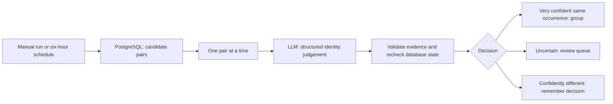

# Deduplicating events with n8n

Use [Skynet Countdown — Reconcile Events](<n8n/Skynet Countdown - Reconcile Events.json>) alongside the existing [v1.2 collection workflow](<n8n/Skynet Countdown v1.2.json>). It checks both historical records and future additions, automatically groups very confident matches, and puts uncertain cases in a PostgreSQL review queue.

The classifier decides whether two records describe **the same real-world occurrence**. Fixed database functions apply the decision. It has no database tools and cannot write SQL, change scores or delete sources.

## What it does



The collection workflow still upserts assessments by exact `source_url` and stories by `assessment_id`. Those keys prevent repeated rows for the same source. Reconciliation handles different sources covering one event.

An accepted match adds a reversible child-to-parent link in `event_parents`. The earlier-created event remains the public identity, with ID as the tie-breaker. Its selected assessment and story remain selected. The API combines the group's histories, emits one incident and counts its selected score once. It does not add, average or maximise the sources' scores.

Every source row, assessment version, editorial version and original public ID remains stored. Old report links resolve to the retained incident. CSV exports preserve original identities and add `resolved_event_id` / `resolved_public_id`. Corrections recalculate the clock, so removing double counting can move it away from midnight.

### Automatic decision rules

All of these are required to group a pair automatically:

- The model returns `same_event` with confidence **at least 0.98**.
- It identifies the same actor, action and occurrence, with no material follow-up.
- The database's incident dates for the groups are within **seven days**.
- Each side has a verbatim evidence excerpt of at least 24 characters, checked against the supplied factual record.
- Both events are still separate roots and their fingerprints and evidence still match what was classified.
- `auto_merge` is enabled.

The evidence contains titles, dates, source URLs and factual story text. Scoring rationales and analytical takes are excluded: repeated rubric language is a poor basis for event identity. The prompt treats all record content as evidence, including any text trying to give the model instructions.

**0.98 is a model-reported confidence threshold, not a measured 98% accuracy rate.** This is an editorial automation rule. The audit log and undo function remain necessary; inspect the early results against their source articles.

`different_event` at confidence 0.98 or above is recorded without grouping. Other valid results enter the review queue. Malformed output stops that execution; it cannot apply a merge. A changed record produces a `stale` result and can be considered again from current data.

### Candidate selection and limits

Default settings are **20 pairs per run**, a **45-day date window**, and a run every **six hours**. The window measures the distance between two incident dates; it is not a cutoff excluding old records. Historical pairs qualify too.

For these checks, a group's date is the latest `incident_date` among its current assessment rows. The public timeline still uses the retained assessment's selected date. Candidate evidence is capped at 12,000 characters per group, including up to 2,400 characters of each source's factual story; the classifier does not fetch or independently verify the linked articles.

Pairs within seven days can qualify without shared title words. Pairs farther apart need title overlap. Overlap ranks the candidates; it never proves duplication. Citation markers are removed before matching title words. The database caps each run at 100 pairs, and remembers classified pairs while their underlying state is unchanged.

This is bounded candidate matching, so it can miss duplicates, especially records with inconsistent dates or very different wording. A scheduled run can leave a new duplicate visible until reconciliation catches up. The six-hour interval is configurable in n8n. There is no embedding service, vector store or additional server to operate.

## 1. Deploy the application support

Deploy this change to **both Railway and GitHub Pages** before running a workflow that can merge records. The API needs to resolve event groups; the frontend needs to resolve old report links. The updated API also works before the new tables exist, which allows the code to deploy first.

Check the Railway deployment succeeds and `/health` is healthy. Confirm a report still opens on the site. Existing collection can continue during this rollout.

## 2. Apply the database migration

In Neon's SQL Editor, select the same project, branch and database used by the API and n8n. The database in this project's connection is `incident_log`; a different database in the same project can have completely different tables. Verify the selection before applying the migration:

```sql
SELECT current_database() AS database,
       to_regclass('public.assessments') AS assessments,
       to_regclass('public.stories') AS stories,
       to_regclass('public.events') AS events,
       to_regclass('public.record_history') AS record_history;
```

All four table columns must be non-null. If `events` is null, compare the SQL Editor's branch/database selection with the connection used by Railway and n8n. The database name alone does not identify the Neon branch. Do not create an empty `events` table to get past this check: the existing history and canonical selections must be present. Migration 002 now reports the database name and missing tables before making any changes.

If the editor reports that the transaction is aborted after a failed migration, run `ROLLBACK;` before retrying. Once the selected database has the required tables, take a backup or use your normal Neon recovery process, then run the contents of:

[db/002_event_reconciliation.sql](db/002_event_reconciliation.sql)

The prerequisite is the existing `events` / `record_history` schema from migration 001. Migration 002 is transactional and rerunnable. Applying it creates the grouping and decision infrastructure; **it does not merge any records**. Source writes and merge decisions use a shared transaction lock to avoid approving partially updated evidence. This serialises writes briefly, which is appropriate for this collection volume.

The migration extends the existing `skynet_api_reader` permissions to read the parent links and the decision timestamps needed for cache freshness. It does not rotate credentials or grant the API write access.

Verify the new schema and inspect candidates without a model call:

```sql
SELECT count(*) AS active_groups FROM public.event_parents;
SELECT pair FROM public.skynet_dedup_candidates(5, 45);
```

Run the existing read-only application validation too:

```sh
npm run db:check
```

### PostgreSQL credential permissions

If n8n uses the same owner role that applies the migration, it already has the required access. For a separate writer role, grant its real role name the following permissions; `your_n8n_role` below is a placeholder:

```sql
GRANT USAGE ON SCHEMA public TO your_n8n_role;
GRANT SELECT ON public.events, public.assessments, public.stories,
  public.record_history, public.event_parents, public.event_identity_decisions
  TO your_n8n_role;
GRANT EXECUTE ON FUNCTION public.skynet_dedup_candidates(integer, integer)
  TO your_n8n_role;
GRANT EXECUTE ON FUNCTION public.skynet_record_duplicate_decision(jsonb, jsonb, jsonb)
  TO your_n8n_role;
```

The reconciliation credential needs no direct writes to the new tables. Review and undo are owner operations in the SQL Editor; they are not exposed through the public API.

## 3. Import and connect the n8n workflow

1. Create a workflow in n8n and choose **Import from File**. Select `n8n/Skynet Countdown - Reconcile Events.json`.
2. On **Neon: Fetch Candidate Pairs** and **Neon: Record Decision**, select your Neon PostgreSQL credential. Use the same database as the collection workflow and keep TLS enabled.
3. On **OpenAI Identity Model**, select your OpenAI credential.
4. Open **Set: Reconciliation Configuration**:

   | Setting | Default | Meaning |
   | --- | --- | --- |
   | `candidate_limit` | `20` | Maximum pairs examined this run; database maximum 100 |
   | `date_window_days` | `45` | Maximum distance between candidate dates |
   | `auto_merge` | `true` | Apply matches passing every automatic rule |
   | `model` | `gpt-5.4` | Used by the model node and recorded in the audit log |
   | `prompt_version` | `event-identity-1` | Audit label for this classification prompt |

   Use a model available to your account. Change it in this configuration node so the model call and audit label stay aligned.

5. Leave **Loop Over Candidate Pairs** at batch size **1**. Serial processing keeps one pair per model call. The validator retrieves the current loop run explicitly instead of relying on the LLM node to preserve item linking.
6. Keep the workflow inactive while doing its first manual run. The export has no embedded credentials and is inactive by default.

The Postgres nodes use `$1`, `$2` and `$3` with Query Parameters. Keep those expressions intact. The model's JSON is passed as data to a fixed function; it is never interpolated into SQL.

**Classify Event Identity** explicitly lists the nine required JSON fields. **Require Specific Output Format** stays off and there is no Structured Output Parser attached. **Validate and Rebind Pair** accepts plain JSON and the fenced `output` wrapper observed in n8n 2.13.2, then checks all fields, types, lengths and evidence substrings. Formatting is removed without changing or filling in decision values. Missing fields and invalid evidence stop the workflow before PostgreSQL receives a decision.

### Fixing “Model output doesn't fit required format”

On n8n 2.13.2, a reported failure returned valid classification fields inside a fenced `{"output": {...}}` object. The Structured Output Parser rejected that response before the workflow's validator ran. The current export uses the Code validator directly and includes a regression test for that exact response.

Import the updated JSON into your reconciliation workflow, reconnect credentials if needed, and execute a fresh manual run with `candidate_limit=1`. Keep only one reconciliation schedule active. No database migration or application redeployment is needed for this formatting fix.

If updating the nodes in place, copy the updated prompt from **Classify Event Identity** and the entire code from **Validate and Rebind Pair**, turn off **Require Specific Output Format**, and remove the old parser connection. Turning off the parser alone leaves the older validator unable to handle the reported fenced wrapper. Leave **On Error** set to stop: a malformed classification must not reach the database.

## 4. Run and inspect the first batch

Use a small `candidate_limit`, such as **5**, for the first manual execution. `auto_merge=true` implements the chosen automatic policy immediately.

For a queue-only rehearsal, set `auto_merge=false`. This still writes decisions: potential matches and uncertain cases are queued, while confident differences are recorded. **It is not a dry run.** Switching back to `true` does not automatically accept already queued, unchanged pairs. Review those proposals explicitly with the function below.

Inspect **Neon: Record Decision** outputs. Expected actions are `merge`, `review`, `different` or `stale`. A run with no candidate rows finishes without a model call. Repeating a run does not classify unchanged completed pairs again.

View recent decisions:

```sql
SELECT id, action, left_event_id, right_event_id, confidence,
       rationale, model, execution_id, created_at
FROM public.event_identity_decisions
ORDER BY id DESC
LIMIT 30;
```

After accepted matches, check the site and `npm run db:check`. The API cache can take 30 seconds to expire; a visible browser tab refreshes every 60 seconds. The retained report should contain both sources' histories, and old links should open that same report. The incident count and clock points may fall; the assessment and editorial history counts should remain intact.

## 5. Review uncertain pairs

The durable queue lives in PostgreSQL, so it remains available across n8n executions. Read it in Neon's SQL Editor:

```sql
SELECT q.proposal_id, q.is_fresh, q.confidence,
       l.public_id AS left_id, r.public_id AS right_id,
       q.rationale,
       q.evidence #>> '{pair,left,evidence}' AS left_evidence,
       q.evidence #>> '{pair,right,evidence}' AS right_evidence
FROM public.event_duplicate_review_queue q
JOIN public.events l ON l.id = q.left_event_id
JOIN public.events r ON r.id = q.right_event_id
ORDER BY q.created_at, q.proposal_id;
```

Check the underlying source articles. A later ruling, resignation, release, deployment or newly disclosed incident involving the same organisation is a separate development. A second report of the same occurrence is a duplicate. A summary covering several incidents should not be merged into one of its individual examples.

To accept, replace `NULL` with the chosen `proposal_id` and supply your reason/name:

```sql
SELECT public.skynet_review_duplicate(
  NULL::bigint,
  true,
  'Both articles report the same evaluation on the same date.',
  'James'
);
```

Use `false` instead of `true` to reject a match. The function rechecks current state before accepting. `is_fresh=false` means the sources or grouping changed since classification; an old proposal cannot apply to the new state. A later run can produce a current proposal. The audit trail retains the stale one.

## 6. Enable ongoing reconciliation

Restore the chosen limit and `auto_merge=true`, then publish/activate the workflow. Its schedule runs every six hours. It operates alongside v1.2 and requires no wiring into the parallel assessment/story branches. Lower the interval if you want duplicates corrected sooner; model calls are bounded per run and previously classified unchanged pairs are skipped.

For the initial backlog, run several manual batches. If dates are known to be inconsistent, temporarily increase `date_window_days`; older records do not otherwise need a special historical mode. The seven-day automatic merge guard still applies. A limit of 20 does not mean the entire archive has been checked after one execution.

No application deployment is needed for later decisions or data additions. Check the queue periodically and monitor failed n8n executions. This workflow does not send messages or add public review controls.

## Undo a grouping

Find its active edge first:

```sql
SELECT ep.child_event_id, child.public_id AS child_public_id,
       ep.parent_event_id, parent.public_id AS parent_public_id,
       ep.merge_decision_id
FROM public.event_parents ep
JOIN public.events child ON child.id = ep.child_event_id
JOIN public.events parent ON parent.id = ep.parent_event_id;
```

Replace the two `NULL` values with that edge's IDs:

```sql
SELECT public.skynet_unmerge_event(
  NULL::bigint, -- child_event_id
  NULL::bigint, -- merge_decision_id
  'These were separate evaluations; restore the second event.',
  'James'
);
```

Undo removes that exact link and appends a decision. A child with its own descendants is restored with that subgroup intact. The current separated groups are remembered so an unchanged pair is not immediately merged again by the schedule. Later source changes can make the pair eligible for a fresh assessment. Preserved source versions and score selections are not rewritten by merge or undo.

## Verification and implementation references

The repository tests exercise grouping, history preservation, clock recalculation, stale decisions, retries, concurrent decisions, undo and alias routes. Database tests only accept a local `skynet_test…` database:

```sh
npm test
npm run lint
npm run build
TEST_DATABASE_URL=postgresql://localhost/skynet_test node --experimental-strip-types --test server/reconciliation.integration.test.ts
```

The JSON and validator are tested locally, and node parameters are checked against upstream n8n definitions. An authenticated import/run in your n8n instance is still needed to confirm your installed node versions, credentials and model access. No live database migration or grouping is performed by the repository test suite.

- [Database migration and decision functions](db/002_event_reconciliation.sql)
- [API identity resolution](server/event-identity.ts)
- [n8n Postgres query parameters](https://docs.n8n.io/integrations/builtin/app-nodes/n8n-nodes-base.postgres/#use-query-parameters)
- [Loop Over Items](https://docs.n8n.io/integrations/builtin/core-nodes/n8n-nodes-base.splitinbatches/)
- [Basic LLM Chain](https://docs.n8n.io/integrations/builtin/cluster-nodes/root-nodes/n8n-nodes-langchain.chainllm/)
- [n8n Code node](https://docs.n8n.io/integrations/builtin/core-nodes/n8n-nodes-base.code/)
